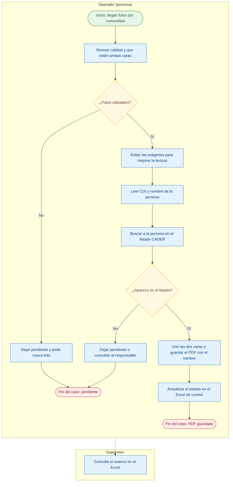
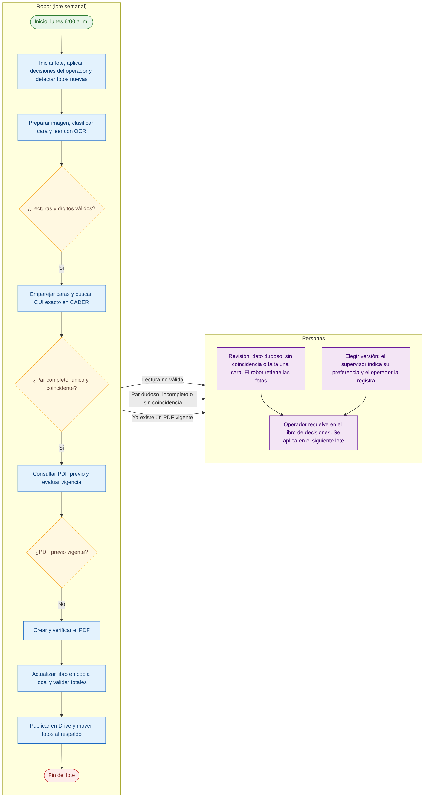
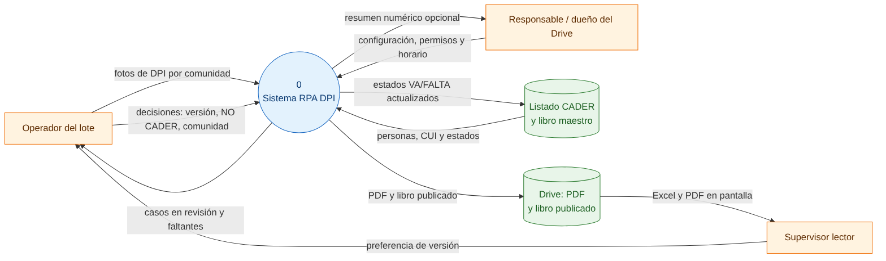
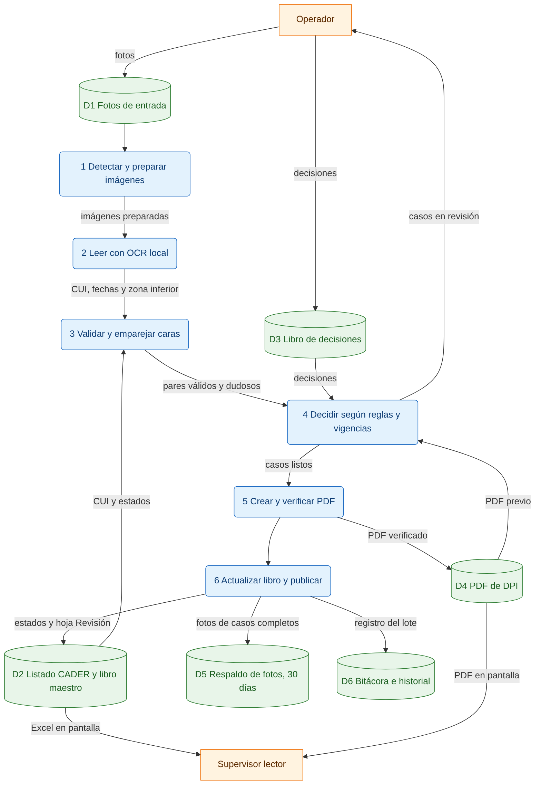
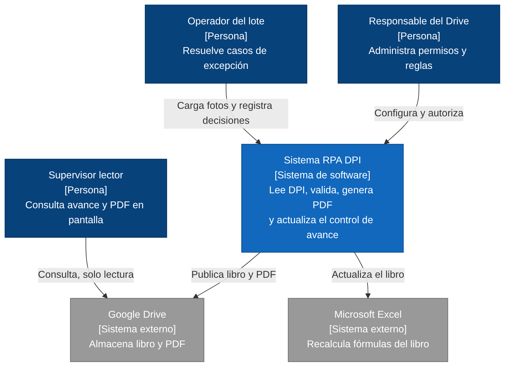
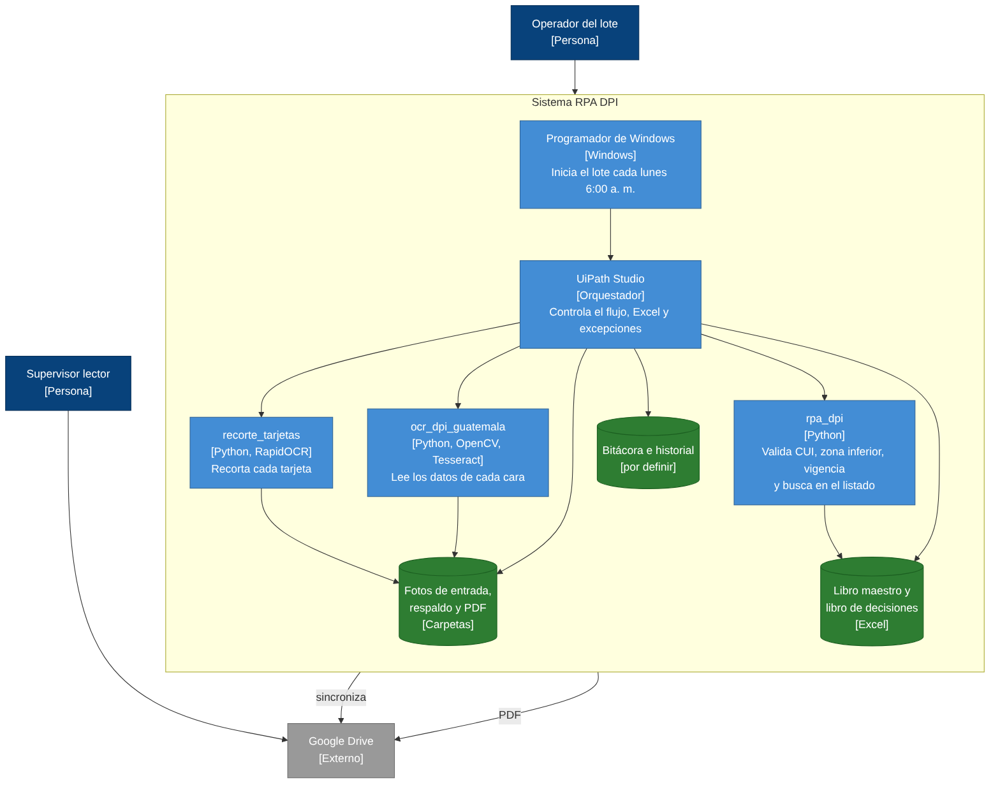

# Diagramas

Esta página reúne los modelos del proceso, de los datos y de la arquitectura. Todos están hechos con datos ficticios y no muestran información personal.

> **Nota sobre la notación.** Los diagramas de proceso usan una notación de flujo simplificada, inspirada en BPMN: actividades, decisiones, inicio y fin, agrupadas por quién las realiza. No incluyen todos los elementos formales de BPMN (por ejemplo, eventos intermedios o piscinas con mensajes).

## 1. Proceso actual (As-Is)

Representa el trabajo manual de hoy: una persona recibe las fotos, las revisa, las edita, identifica a la persona, la busca en el listado, prepara el PDF y actualiza el Excel. Los casos que no se pueden resolver quedan pendientes.

**Qué se observa.**

- Todo el trabajo recae en una sola persona, con pasos repetitivos (editar, leer, buscar, unir, guardar, actualizar).
- La identificación depende de la lectura humana del CUI y de la búsqueda manual en el listado.
- Cuando algo falla, el caso queda pendiente sin un registro uniforme del motivo.

## 2. Proceso propuesto (To-Be)

Muestra el lote semanal automatizado. El robot hace los pasos mecánicos y deriva a una persona todo lo que no es confiable. Las decisiones del operador se aplican en el lote siguiente.

**Qué cambia respecto al proceso actual.**

- La identidad se valida con el CUI exacto y con una comprobación cruzada de ambas caras, no con la lectura de una sola persona.
- Cada caso dudoso queda con un motivo registrado y una cola de revisión.
- Un PDF previo vigente nunca se sobrescribe sin una decisión humana.
- El avance se publica de forma automática y verificada.

## 3. Diagrama de flujo de datos, nivel 0

Muestra el sistema como un único proceso y sus intercambios con las personas y los almacenes de datos externos.

| Elemento | Tipo | Descripción |
| --- | --- | --- |
| Operador del lote | Entidad externa | Entrega las fotos, registra decisiones y recibe los casos en revisión. |
| Supervisor lector | Entidad externa | Consulta el Excel y los PDF en pantalla e indica su preferencia de versión. |
| Responsable / dueño del Drive | Entidad externa | Define la configuración, los permisos y el horario; puede recibir un resumen numérico. |
| Listado CADER y libro maestro | Almacén | Personas, CUI y estados VA/FALTA. |
| Drive | Almacén | PDF y libro publicado para los supervisores. |

## 4. Diagrama de flujo de datos, nivel 1

Descompone el sistema en seis procesos y seis almacenes de datos.

| Proceso | Entrada principal | Salida principal |
| --- | --- | --- |
| 1. Detectar y preparar imágenes | Fotos de entrada | Imágenes preparadas, hash de cada archivo |
| 2. Leer con OCR local | Imágenes preparadas | CUI, fechas y líneas de la zona inferior |
| 3. Validar y emparejar caras | Lecturas del OCR, listado CADER | Pares válidos y casos dudosos |
| 4. Decidir según reglas y vigencias | Pares, decisiones, PDF previo | Casos listos para PDF o casos en revisión |
| 5. Crear y verificar PDF | Casos listos | PDF verificado |
| 6. Actualizar libro y publicar | PDF verificado | Estados en el libro, fotos al respaldo, registro del lote |

| Almacén | Contenido | Retención |
| --- | --- | --- |
| D1 Fotos de entrada | Fotos de anverso y reverso por comunidad | Hasta completar el caso |
| D2 Listado CADER y libro maestro | Personas, CUI, estados y hoja Revisión | Permanente |
| D3 Libro de decisiones | Decisiones del operador | Hasta aplicarlas |
| D4 PDF de DPI | Un PDF por persona | Nunca se borra automáticamente |
| D5 Respaldo de fotos | Fotos de casos completos | 30 días |
| D6 Bitácora e historial | Un registro por lote y por caso, vigencias, hash | 12 meses |

## 5. C4 nivel 1: contexto del sistema

Muestra el sistema como una caja única, las personas que lo usan y los sistemas externos con los que se relaciona.

## 6. C4 nivel 2: contenedores

Separa las piezas que componen el sistema: el programador, el orquestador, los tres módulos de Python y los almacenes.

| Contenedor | Tecnología | Responsabilidad |
| --- | --- | --- |
| Programador de Windows | Windows | Inicia el lote cada lunes a las 6:00 a. m. |
| UiPath Studio | UiPath | Orquesta el flujo, el Excel, las excepciones y la programación. |
| `recorte_tarjetas` | Python, RapidOCR | Recorta cada tarjeta de las fotografías. |
| `ocr_dpi_guatemala` | Python, OpenCV, Tesseract | Lee los datos de cada cara. |
| `rpa_dpi` | Python | Valida CUI, zona inferior y vigencia; consulta el listado. |
| Libro maestro y libro de decisiones | Excel | Estado del avance y decisiones del operador. |
| Bitácora e historial | Por definir | Hash, vigencias, historial de reemplazos y trazas del lote. |
| Fotos, respaldo y PDF | Carpetas | Almacenamiento de archivos. |

> **Pendiente de decisión.** El almacén de la bitácora (hoja de Excel, archivo CSV o base local) aún no está definido. Hasta decidirlo, queda marcado como "por definir".
